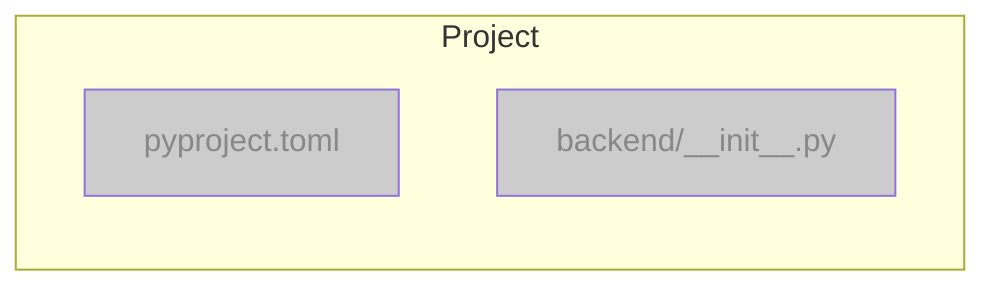
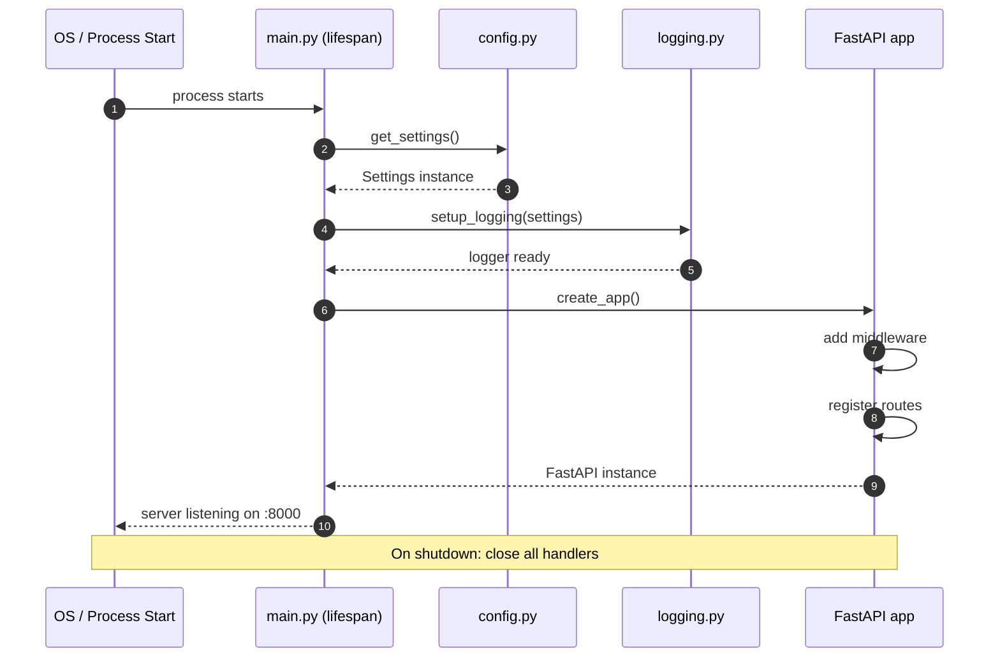
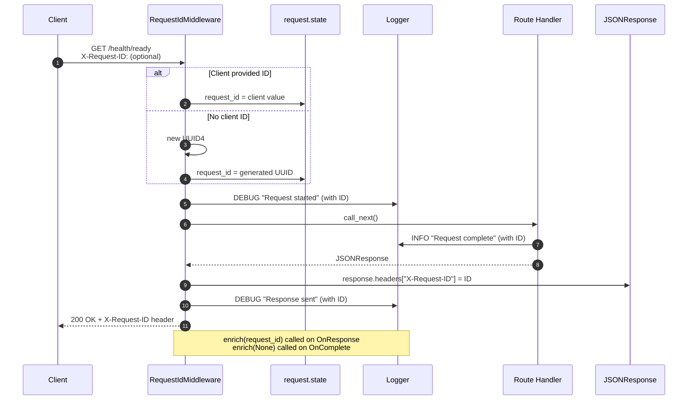
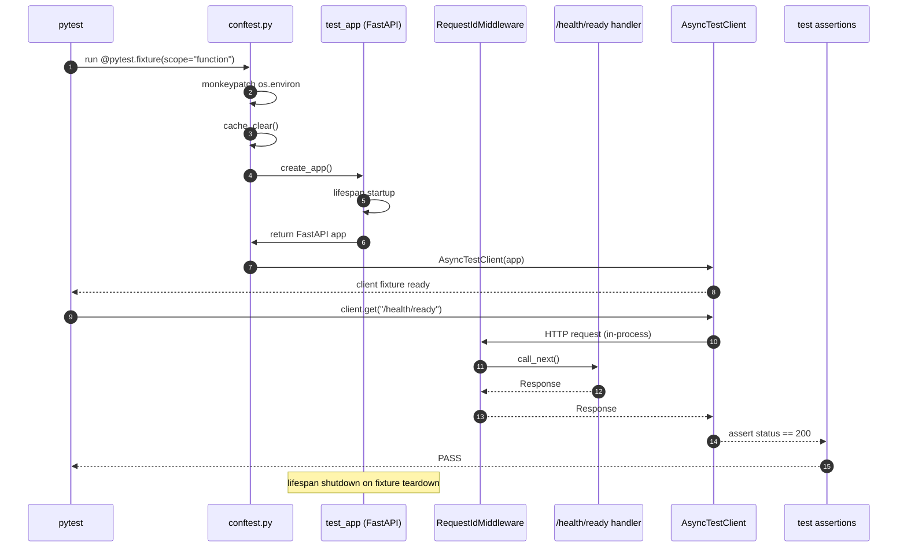
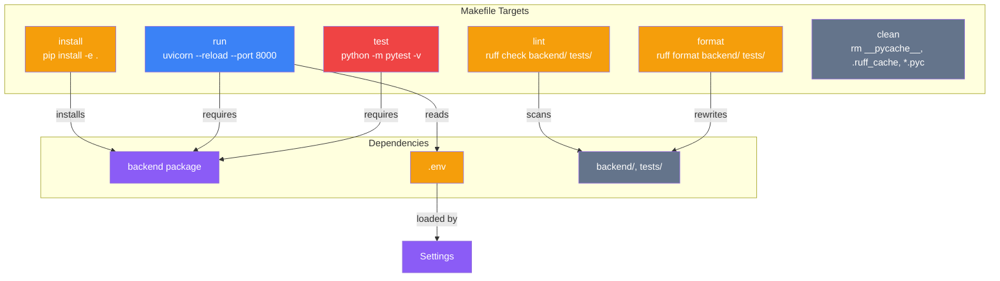
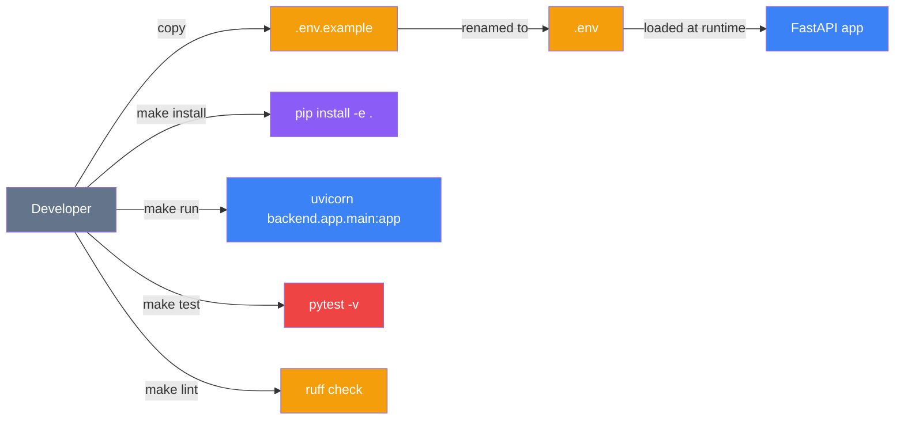

# Phase 1 — Infrastructure Design Evolution

> **CloudDesk Autonomous Customer Support & Resolution Platform**
> Phase 1: Foundation & Infrastructure

This document traces the **infrastructure** that evolved during Phase 1 — not the external network or container topology (none exists yet in Phase 1), but the **in-process wiring, request routing, configuration loading, logging pipeline and test harness plumbing** that every later phase depends on.

Every diagram shows the *infrastructure* layer: how components are wired together, how data moves between them, and where new connections were added at each subtask.

---

## Starting Point (Before Phase 1)

The project was an empty Python scaffold. There were no components to wire, no process to start, no configuration to load.



**Infrastructure state:** No running process. No env var loading. No logging. No HTTP stack.

---

## P1-1: Settings Pipeline & Logging Pipeline

### What was wired

Two independent **pipelines** were created:

| Pipeline | Input | Transformation | Output |
|---|---|---|---|
| **Settings Pipeline** | OS env vars / `.env` file | `pydantic.BaseSettings` typing + validation | Singleton `Settings` instance via `get_settings()` |
| **Logging Pipeline** | `Settings` (level, format, dir) | Logger + formatters + handlers | `logs/app.log` (JSON) + console (coloured text) |

### Settings Pipeline

```mermaid
graph LR
    subgraph Environment
        OS[OS Environment Variables]
        ENV[.env File]
    end

    subgraph config.py
        SETTINGS[Settings class<br/>120 fields, pydantic BaseSettings]
        GET["get_settings()<br/>memoised singleton"]
    end

    subgraph Consumers
        CORE[Other modules<br/>(logging, main, middleware)]
    end

    OS -->|os.environ| SETTINGS
    ENV -->|dotenv auto-load| SETTINGS
    SETTINGS -->|cached| GET
    GET -->|dependency injection| CORE

    style OS fill:#f59e0b,color:#fff
    style ENV fill:#f59e0b,color:#fff
    style SETTINGS fill:#8b5cf6,color:#fff
    style GET fill:#8b5cf6,color:#fff
    style CORE fill:#64748b,color:#fff
```

**Key wiring decisions:**

- **`get_settings()` is a cached factory** — first call instantiates `Settings()` and stores it in `settings_cache`. Subsequent calls return the same object. `cache_clear()` resets the cache (used by tests).
- **`pydantic.BaseSettings`** auto-loads `.env` files and reads `os.environ`. No manual parsing.
- **Default values are in the class** — `.env` is optional at dev time; every field has a fallback.
- **120 lines** cover: app identity, server config, database URLs, LLM keys (OpenAI, Ollama, Azure, OpenRouter), embeddings, Redis, JWT auth, rate limits, logging config, LangGraph checkpointing, mock services, and knowledge base paths.

### Logging Pipeline

```mermaid
graph TB
    subgraph config.py
        CONFIG[Settings.log_level<br/>Settings.log_format<br/>Settings.log_dir]
    end

    subgraph logging.py
        SETUP[setup_logging()]
        JSON_FMT[JSONFormatter]
        COLOR_FMT[ColourisedFormatter]
        ROTATING[RotatingFileHandler<br/>20 MB, 5 backups]
        CONSOLE[StreamHandler<br/>sys.stderr]
        FILTER[RequestIdFilter]
        ENRICH[enrich(request_id)]
    end

    subgraph Output
        LOG_FILE[logs/app.log]
        TERMINAL[Terminal (coloured)]
    end

    CONFIG -->|read by| SETUP
    SETUP -->|creates| JSON_FMT
    SETUP -->|creates| COLOR_FMT
    SETUP -->|creates| ROTATING
    SETUP -->|creates| CONSOLE
    SETUP -->|adds| FILTER
    JSON_FMT -->|formats| ROTATING
    COLOR_FMT -->|formats| CONSOLE
    ROTATING -->|writes| LOG_FILE
    CONSOLE -->|writes| TERMINAL
    ENRICH -->|injects into| FILTER

    style CONFIG fill:#8b5cf6,color:#fff
    style SETUP fill:#3b82f6,color:#fff
    style JSON_FMT fill:#10b981,color:#fff
    style COLOR_FMT fill:#10b981,color:#fff
    style ROTATING fill:#059669,color:#fff
    style CONSOLE fill:#059669,color:#fff
    style FILTER fill:#f59e0b,color:#fff
    style ENRICH fill:#f59e0b,color:#fff
    style LOG_FILE fill:#64748b,color:#fff
    style TERMINAL fill:#64748b,color:#fff
```

**How it works:**

1. `setup_logging()` reads `Settings.log_level`, `log_format`, and `log_dir`.
2. Creates a `RotatingFileHandler` that writes JSON-formatted lines to `logs/app.log` (max 20 MB, keeps 5 backup files).
3. Creates a `StreamHandler` that writes coloured text to `sys.stderr` for console output.
4. Registers `RequestIdFilter` on the root logger — it looks for `request_id` in every log record.
5. `enrich(request_id)` sets the request ID on the current thread's logging context so every subsequent log line includes it.

### P1-1 Wiring Summary


---

## P1-2: HTTP Stack, Routing & Middleware Chain

### What was wired

Three new infrastructure components appeared:

1. **FastAPI Application Factory** — `create_app()` in `main.py`
2. **Request-ID Middleware** — `RequestIdMiddleware` in `middleware/request_id.py`
3. **Health Endpoints** — `/health/live` and `/health/ready`

These are wired into a **request processing pipeline** — the first time data flows through the application.

### Application Factory & Lifespan



**Key wiring:**
- `get_settings()` is called once during lifespan startup — the `Settings` instance lives for the entire process.
- `setup_logging()` is called with settings values — formatters and handlers are created once.
- `FastAPI()` is constructed with `middleware=[RequestIdMiddleware]` and `lifespan=app_lifespan`.
- Routes are registered with `@router.get()` decorators.

### Request Processing Pipeline (Middleware Chain)

This is the core infrastructure concept of P1-2: every HTTP request passes through a **pipeline** of middleware before reaching a route handler.

```mermaid
graph LR
    subgraph Incoming Request
        CLIENT[Client]
    end

    subgraph Middleware Layer
        REQID[RequestIdMiddleware<br/>OnStart: generate/preserve ID<br/>OnReceive: set request.state.request_id<br/>OnResponse: call enrich()<br/>OnComplete: call enrich(None)]
    end

    subgraph Routing Layer
        ROUTER[FastAPI Router]
    end

    subgraph Handlers
        LIVE[/health/live → live_health()]
        READY[/health/ready → ready_health()]
    end

    subgraph Response
        HEADERS[Response headers<br/>+ X-Request-ID]
    end

    CLIENT -->|HTTP GET| REQID
    REQID -->|request.state.request_id set| ROUTER
    ROUTER -->|match /health/live| LIVE
    ROUTER -->|match /health/ready| READY
    LIVE -->|JSONResponse| HEADERS
    READY -->|JSONResponse| HEADERS
    HEADERS -->|HTTP 200| CLIENT

    style CLIENT fill:#64748b,color:#fff
    style REQID fill:#f59e0b,color:#fff
    style ROUTER fill:#3b82f6,color:#fff
    style LIVE fill:#10b981,color:#fff
    style READY fill:#10b981,color:#fff
    style HEADERS fill:#059669,color:#fff
```

### Request-ID Middleware — Detailed Flow



**The `enrich()` connection:** The middleware calls `enrich(request_id)` from logging.py at `on_response` and `enrich(None)` at `on_complete`. This means:
- Every log line during request processing includes the request ID.
- When the response is sent, the ID is cleared so subsequent unrelated logging is not polluted.

### Route Wiring

```mermaid
graph TB
    subgraph main.py
        LIVE_ROUTE[@router.get /health/live]
        READY_ROUTE[@router.get /health/ready]
    end

    subgraph Handlers
        LIVE_FUNC[live_health() → {"status": "ok"}]
        READY_FUNC[ready_health() → {"status": "ok", "app_version": ..., "env": ..., "timestamp": ...}]
    end

    subgraph Query Params
        VERBOSE[verbose=true/false<br/>default: true]
    end

    LIVE_ROUTE -->|calls| LIVE_FUNC
    READY_ROUTE -->|calls| READY_FUNC
    VERBOSE -->|passed to| READY_FUNC

    style LIVE_ROUTE fill:#3b82f6,color:#fff
    style READY_ROUTE fill:#3b82f6,color:#fff
    style LIVE_FUNC fill:#10b981,color:#fff
    style READY_FUNC fill:#10b981,color:#fff
    style VERBOSE fill:#f59e0b,color:#fff
```

### P1-2 Wiring Summary

```mermaid
graph TB
    ENV[.env / OS vars] --> CONFIG[Settings]
    CONFIG --> MAIN[create_app]
    MAIN --> LOGGING[setup_logging]
    MAIN --> MIDDLEWARE[RequestIdMiddleware]
    MAIN --> ROUTES[/health/live, /health/ready]
    MIDDLEWARE -->|wraps| ROUTES
    MIDDLEWARE -->|enrich()| LOGGING
    LOGGING --> LOGS[logs/app.log + console]
    ROUTES --> RESPONSE[HTTP 200 JSON]

    style ENV fill:#f59e0b,color:#fff
    style CONFIG fill:#8b5cf6,color:#fff
    style MAIN fill:#3b82f6,color:#fff
    style LOGGING fill:#3b82f6,color:#fff
    style MIDDLEWARE fill:#f59e0b,color:#fff
    style ROUTES fill:#10b981,color:#fff
    style LOGS fill:#059669,color:#fff
    style RESPONSE fill:#64748b,color:#fff
```

---

## P1-3: Test Harness Wiring

### What was wired

The test infrastructure **mirrors** the application wiring but uses isolated, in-memory substitutes. No external services are involved.

### Fixture Wiring

```mermaid
graph TB
    subgraph conftest.py
        PATCH[_patch_settings<br/>monkeypatch + cache_clear]
        MOCK[mock_settings<br/>APP_ENV=test, APP_NAME=TestApp]
        TEST_APP[test_app<br/>create_app()]
        CLIENT[test_client<br/>AsyncTestClient]
    end

    subgraph Test Files
        T_HEALTH[test_health_endpoints.py]
        T_REQID[test_request_id.py]
        T_SETTINGS[test_settings.py]
    end

    subgraph Application
        CONFIG[config.py]
        MAIN[main.py]
        MID[middleware/request_id.py]
    end

    PATCH -->|monkeypatch os.environ| CONFIG
    MOCK -->|uses| PATCH
    TEST_APP -->|calls| MAIN
    CLIENT -->|wraps| TEST_APP

    MOCK -->|provides| T_HEALTH
    MOCK -->|provides| T_REQID
    MOCK -->|provides| T_SETTINGS

    TEST_APP -->|creates| CONFIG
    TEST_APP -->|creates| MAIN
    TEST_APP -->|creates| MID

    style PATCH fill:#f59e0b,color:#fff
    style MOCK fill:#f59e0b,color:#fff
    style TEST_APP fill:#f59e0b,color:#fff
    style CLIENT fill:#f59e0b,color:#fff
    style T_HEALTH fill:#ef4444,color:#fff
    style T_REQID fill:#ef4444,color:#fff
    style T_SETTINGS fill:#ef4444,color:#fff
    style CONFIG fill:#8b5cf6,color:#fff
    style MAIN fill:#3b82f6,color:#fff
    style MID fill:#f59e0b,color:#fff
```

### Test Request Flow



**Key isolation:**
- `AsyncTestClient` does **not** make real HTTP calls — it calls the handler function directly through the WSGI/ASGI interface.
- `monkeypatch` ensures no real env vars leak into tests.
- `cache_clear()` ensures each test starts with a fresh `Settings` instance.
- Fixture scope is `"function"` — each test gets its own app, client, and settings.

### P1-3 Wiring Summary

```mermaid
graph LR
    subgraph Test Infrastructure
        PYTEST[pytest] --> CONFT[conftest.py]
        CONFT --> FIXTURES[mock_settings, test_app, test_client]
    end

    subgraph Test Cases
        FIXTURES --> T1[test_health_endpoints.py<br/>5 tests]
        FIXTURES --> T2[test_request_id.py<br/>5 tests]
        FIXTURES --> T3[test_settings.py<br/>2 tests]
    end

    subgraph Application (isolated per test)
        APP[create_app()]
        APP --> MID[RequestIdMiddleware]
        APP --> ROUTES[/health/live, /health/ready]
    end

    style FIXTURES fill:#f59e0b,color:#fff
    style T1 fill:#ef4444,color:#fff
    style T2 fill:#ef4444,color:#fff
    style T3 fill:#ef4444,color:#fff
    style APP fill:#3b82f6,color:#fff
```

---

## P1-4: Development Environment Wiring

### What was wired

Two files that wire the **developer's local environment** to the application:

1. **`Makefile`** — CLI targets that call Python tooling in the right order.
2. **`.env.example`** — Template that maps to every `Settings` field.

### Makefile Target Dependencies



### .env.example → Settings Mapping

```mermaid
graph TB
    subgraph .env.example
        APP_VARS[APP_NAME, APP_VERSION, APP_ENV, DEBUG]
        SERVER_VARS[HOST, PORT, WORKERS]
        DB_VARS[DATABASE_URL, REDIS_URL]
        LLM_VARS[OPENAI_API_KEY, OLLAMA_BASE_URL, AZURE_*]
        EMBED_VARS[EMBEDDING_MODEL, CHUNK_SIZE, ...]
        AUTH_VARS[JWT_SECRET_KEY, ACCESS_TOKEN_EXPIRE_MINUTES]
        LOG_VARS[LOG_LEVEL, LOG_FORMAT, LOG_DIR]
    end

    subgraph Settings class
        APP_SEC[app_name, app_version, app_env, debug]
        SERVER_SEC[host, port, workers]
        DB_SEC[database_url, redis_url]
        LLM_SEC[openai_api_key, ollama_base_url, azure_... ]
        EMBED_SEC[embedding_model, chunk_size, ...]
        AUTH_SEC[jwt_secret_key, access_token_expire_minutes]
        LOG_SEC[log_level, log_format, log_dir]
    end

    APP_VARS -->|dotenv | APP_SEC
    SERVER_VARS -->|dotenv | SERVER_SEC
    DB_VARS -->|dotenv | DB_SEC
    LLM_VARS -->|dotenv | LLM_SEC
    EMBED_VARS -->|dotenv | EMBED_SEC
    AUTH_VARS -->|dotenv | AUTH_SEC
    LOG_VARS -->|dotenv | LOG_SEC

    style APP_VARS fill:#f59e0b,color:#fff
    style SERVER_VARS fill:#f59e0b,color:#fff
    style DB_VARS fill:#f59e0b,color:#fff
    style LLM_VARS fill:#f59e0b,color:#fff
    style EMBED_VARS fill:#f59e0b,color:#fff
    style AUTH_VARS fill:#f59e0b,color:#fff
    style LOG_VARS fill:#f59e0b,color:#fff
    style APP_SEC fill:#8b5cf6,color:#fff
    style SERVER_SEC fill:#8b5cf6,color:#fff
    style DB_SEC fill:#8b5cf6,color:#fff
    style LLM_SEC fill:#8b5cf6,color:#fff
    style EMBED_SEC fill:#8b5cf6,color:#fff
    style AUTH_SEC fill:#8b5cf6,color:#fff
    style LOG_SEC fill:#8b5cf6,color:#fff
```



### P1-4 Wiring Summary



---

## Phase 1 — Complete Infrastructure Architecture

This is the full wiring diagram showing every infrastructure component, every data flow, and every connection that exists at the end of Phase 1.

```mermaid
graph TB
    subgraph External
        CLIENT[HTTP Client<br/>browser, curl, CI]
        ENV_SOURCE[OS Environment + .env]
    end

    subgraph Configuration Layer
        CONFIG[Settings<br/>config.py]
        GET_SETTINGS[get_settings()<br/>cached singleton]
    end

    subgraph HTTP Layer
        APP[FastAPI App<br/>main.py create_app()]
        MIDDLEWARE[RequestIdMiddleware<br/>request_id.py]
        ROUTER[Router<br/>2 routes registered]
        LIVE[/health/live]
        READY[/health/ready]
    end

    subgraph Logging Layer
        LOGGER[Root Logger<br/>logging.py]
        JSON_HANDLER[RotatingFileHandler<br/>JSON format]
        CONSOLE_HANDLER[StreamHandler<br/>coloured text]
        REQ_FILTER[RequestIdFilter<br/>injects request_id]
    end

    subgraph Test Layer
        CONFT[conftest.py<br/>mock_settings, test_app, test_client]
        TESTS[22 tests<br/>3 test files]
    end

    subgraph Dev Tooling
        MAKE[Makefile<br/>6 targets]
        ENV_EX[.env.example<br/>76 lines, 6 sections]
    end

    subgraph Outputs
        LOG_FILE[logs/app.log]
        TERMINAL[Terminal output]
        RESPONSE[HTTP Response<br/>200 JSON + X-Request-ID]
    end

    %% Configuration wiring
    ENV_SOURCE -->|dotenv + os.environ| CONFIG
    CONFIG -->|instantiated| GET_SETTINGS

    %% App wiring
    GET_SETTINGS -->|passed to| APP
    GET_SETTINGS -->|passed to| LOGGER
    APP -->|lifespan start →| LOGGER
    APP -->|registers| MIDDLEWARE
    APP -->|registers| ROUTER
    ROUTER -->|routes to| LIVE
    ROUTER -->|routes to| READY

    %% Middleware wiring
    MIDDLEWARE -->|wraps every request| ROUTER
    MIDDLEWARE -->|enrich() →| REQ_FILTER

    %% Logging wiring
    LOGGER -->|adds handler| JSON_HANDLER
    LOGGER -->|adds handler| CONSOLE_HANDLER
    LOGGER -->|adds filter| REQ_FILTER
    JSON_HANDLER -->|writes| LOG_FILE
    CONSOLE_HANDLER -->|writes| TERMINAL

    %% Request flow
    CLIENT -->|HTTP GET| MIDDLEWARE
    LIVE -->|returns| RESPONSE
    READY -->|returns| RESPONSE

    %% Test wiring
    CONFT -->|monkeypatches| CONFIG
    CONFT -->|creates| APP
    TESTS -->|uses fixtures from| CONFT

    %% Dev tooling wiring
    ENV_EX -->|copied to| ENV_SOURCE
    MAKE -->|runs| APP
    MAKE -->|runs| TESTS

    style CLIENT fill:#64748b,color:#fff
    style ENV_SOURCE fill:#f59e0b,color:#fff
    style CONFIG fill:#8b5cf6,color:#fff
    style GET_SETTINGS fill:#8b5cf6,color:#fff
    style APP fill:#3b82f6,color:#fff
    style MIDDLEWARE fill:#f59e0b,color:#fff
    style ROUTER fill:#3b82f6,color:#fff
    style LIVE fill:#10b981,color:#fff
    style READY fill:#10b981,color:#fff
    style LOGGER fill:#3b82f6,color:#fff
    style JSON_HANDLER fill:#059669,color:#fff
    style CONSOLE_HANDLER fill:#059669,color:#fff
    style REQ_FILTER fill:#f59e0b,color:#fff
    style CONFT fill:#ef4444,color:#fff
    style TESTS fill:#ef4444,color:#fff
    style MAKE fill:#f59e0b,color:#fff
    style ENV_EX fill:#f59e0b,color:#fff
    style LOG_FILE fill:#64748b,color:#fff
    style TERMINAL fill:#64748b,color:#fff
    style RESPONSE fill:#64748b,color:#fff
```

### Process-Internal Networking

Phase 1 has **no inter-process networking**. All communication is within a single Python process:

| Flow | Mechanism | Components |
|---|---|---|
| Env vars → Settings | `pydantic.BaseSettings` reads `os.environ` | `config.py` |
| Settings → Logger | `setup_logging(settings)` called at startup | `config.py` → `logging.py` |
| Request → Middleware | ASGI `receive`/`send` protocol | `request_id.py` |
| Middleware → Handler | `call_next()` in Starlette middleware | `request_id.py` → route functions |
| Handler → Logger | `get_logger()` returns configured logger | `main.py` → `logging.py` |
| Middleware → Logger | `enrich(request_id)` at response time | `request_id.py` → `logging.py` |
| Handler → Client | `JSONResponse` with headers | route functions → ASGI response |

No external services, no database connections, no message queues, no Docker networks — everything runs in one process on one port (`:8000`).

---

## What Comes Next (Infrastructure Roadmap)

| Phase | Infrastructure addition | New wiring |
|---|---|---|
| **Phase 2** | SQLite in-memory store, data models | `config.database_url` → new `DatabaseService` → new routes |
| **Phase 3** | LLM API calls (OpenAI, Ollama) | `config.openai_api_key` → `LLMService` → agents |
| **Phase 4** | Vector database (ChromaDB), embeddings | new DB process, new network port, semantic search pipeline |
| **Phase 5** | JWT auth middleware, Redis rate limiter | new middleware before routes, Redis container on new port |
| **Phase 6** | Frontend (Next.js), separate origin | CORS wiring, two containers, reverse proxy or docker-compose |
| **Phase 7** | Docker Compose, multi-container networking | `docker-compose.yml`, internal Docker network, service discovery |

Phase 1 laid the foundation: a single-process application with clean configuration, structured logging, request tracing, and full test coverage. Every later phase will add new **external** services and new **wiring** points.
