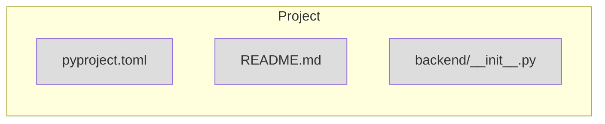
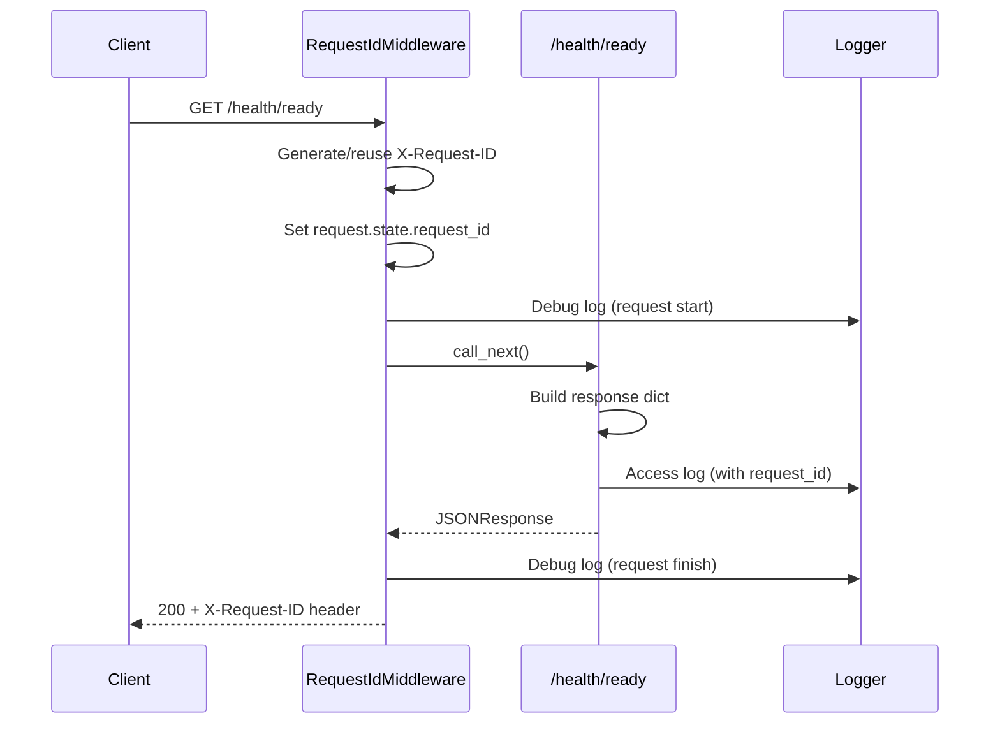
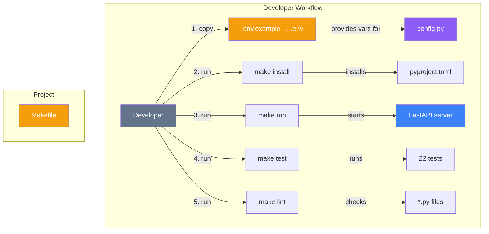

# Phase 1 — Project System Design Evolution

> **CloudDesk Autonomous Customer Support & Resolution Platform**
> Phase 1: Foundation & Infrastructure

This document shows how the system design evolved from an empty project to the complete Phase 1 architecture — one subtask at a time. Each section includes a Mermaid diagram that represents the system state **after** that subtask's work was completed.

---

## Starting Point (Before Phase 1)

The project existed as an empty scaffold: a `pyproject.toml`, `README.md`, and empty package init files — no application logic, no configuration, no logging, no endpoints.



---

## P1-1: Settings & Logging

**What changed:** The first real application components appeared.

Two core modules were added:

1. **`backend/app/core/config.py`** — The `Settings` class (Pydantic `BaseSettings`) loads every environment variable: app name, version, database URL, LLM API keys, embedding settings, RAG parameters, and service ports. A cached `get_settings()` function ensures a single shared instance.

2. **`backend/app/core/logging.py`** — Structured JSON logging with automatic file rotation (20 MB / 5 files). The `setup_logging()` function creates a JSON file handler and a coloured console handler. The `enrich()` function injects `request_id` into every log record so traces are linkable.

```mermaid
graph TB
    subgraph Application
        subgraph Core
            CONFIG[config.py<br/>Settings<br/>get_settings()]
            LOGGING[logging.py<br/>setup_logging()<br/>enrich()]
        end

        ENV[.env / Environment Variables]
        LOGFILE[logs/app.log]
    end

    ENV -->|loads| CONFIG
    CONFIG -->|passed to| LOGGING
    LOGGING -->|writes| LOGFILE

    style CONFIG fill:#3b82f6,color:#fff
    style LOGGING fill:#8b5cf6,color:#fff
    style ENV fill:#f59e0b,color:#fff
    style LOGFILE fill:#10b981,color:#fff
```

**Key design decisions:**
- `Settings` is a Pydantic `BaseSettings` subclass — single source of truth for all configuration.
- `get_settings()` is memoized via a module-level cache with `cache_clear()` for tests.
- Logging uses `JSONFormatter` for machine-readable file output and `ColourisedFormatter` for human-readable console output.
- The `enrich()` function is the bridge between middleware (which sets `request_id`) and logging (which needs it in every record).

---

## P1-2: Health Endpoints & Request-ID Middleware

**What changed:** The application becomes a running HTTP service.

Three new components were added:

1. **`backend/app/main.py`** — The FastAPI application factory. `create_app()` wires settings, logging, middleware, and routes. `lifespan` events run `setup_logging()` on start and close handlers on shutdown. Two health endpoints (`/health/live` and `/health/ready`) provide container lifecycle signals.

2. **`backend/app/middleware/request_id.py`** — `RequestIdMiddleware` generates or preserves `X-Request-ID` on every request, stores it on `request.state`, and echoes it back in the response headers. This is the data source that `enrich()` in `logging.py` uses.

3. **`backend/app/middleware/__init__.py`** — Package initialisation exposing the middleware.

```mermaid
graph TB
    subgraph FastAPI Application
        subgraph Middleware Layer
            REQID[RequestIdMiddleware<br/>X-Request-ID]
        end

        subgraph Routes
            LIVE[/health/live<br/>200 OK]
            READY[/health/ready<br/>200 OK + metrics]
        end

        subgraph Core
            CONFIG[config.py<br/>Settings]
            LOGGING[logging.py<br/>setup_logging()<br/>enrich()]
        end
    end

        MAIN[main.py<br/>create_app()<br/>lifespan]

    MAIN -->|creates| CONFIG
    MAIN -->|runs on start| LOGGING
    MAIN -->|adds| REQID
    MAIN -->|registers| LIVE
    MAIN -->|registers| READY

    REQID -->|sets request.state| LIVE
    REQID -->|sets request.state| READY
    REQID -->|calls| LOGGING

    LIVE -->|logs via| LOGGING
    READY -->|logs via| LOGGING

    subgraph External
        CLIENT[Client]
    end

    CLIENT -->|HTTP GET| LIVE
    CLIENT -->|HTTP GET| READY

    style MAIN fill:#3b82f6,color:#fff
    style REQID fill:#f59e0b,color:#fff
    style LIVE fill:#10b981,color:#fff
    style READY fill:#10b981,color:#fff
    style CONFIG fill:#8b5cf6,color:#fff
    style LOGGING fill:#8b5cf6,color:#fff
    style CLIENT fill:#64748b,color:#fff
```

**Data flow for a single request:**


**Key design decisions:**
- `create_app()` is a factory so tests can create isolated app instances.
- `lifespan` is used instead of `on_event` (the modern FastAPI pattern).
- `/health/live` returns a bare `{"status": "ok"}` — for liveness probes.
- `/health/ready` includes `app_version`, `env` and `timestamp` — for readiness probes.
- The middleware runs **before** route handlers, guaranteeing every request has an ID.

---

## P1-3: Test Harness

**What changed:** The test infrastructure was created to validate everything in P1-1 and P1-2.

New files:

1. **`tests/__init__.py`** — Test package marker.
2. **`tests/conftest.py`** — Shared fixtures: `mock_settings` (overrides Settings via monkeypatch), `test_app` (calls `create_app()`), `test_client` (AsyncTestClient wrapper).
3. **`tests/unit/__init__.py`** — Unit test package marker.
4. **`tests/unit/test_health_endpoints.py`** — 5 tests: live OK, ready OK, ready verbose mode, ready verbose=false, no request-ID required for health.
5. **`tests/unit/test_request_id.py`** — 5 tests: ID generated on every response, ID echoed back, client-supplied ID preserved, `request.state.request_id` set, ID format is valid UUID4.
6. **`tests/unit/test_settings.py`** — 2 tests: default settings load, `cache_clear()` resets the cached instance.

```mermaid
graph TB
    subgraph Application
        subgraph Core
            CONFIG[config.py<br/>Settings]
            LOGGING[logging.py]
        end
        subgraph Middleware
            REQID[RequestIdMiddleware]
        end
        MAIN[main.py<br/>create_app()]
    end

    subgraph Tests
        CONFT[conftest.py<br/>mock_settings<br/>test_app<br/>test_client]
        TEST_HEALTH[test_health_endpoints.py<br/>5 tests]
        TEST_REQID[test_request_id.py<br/>5 tests]
        TEST_SETTINGS[test_settings.py<br/>2 tests]
    end

    CONFT -->|provides| TEST_HEALTH
    CONFT -->|provides| TEST_REQID
    CONFT -->|provides| TEST_SETTINGS

    TEST_HEALTH -->|creates test app from| MAIN
    TEST_REQID -->|creates test app from| MAIN
    TEST_SETTINGS -->|tests| CONFIG

    style CONFT fill:#f59e0b,color:#fff
    style TEST_HEALTH fill:#ef4444,color:#fff
    style TEST_REQID fill:#ef4444,color:#fff
    style TEST_SETTINGS fill:#ef4444,color:#fff
    style CONFIG fill:#8b5cf6,color:#fff
    style LOGGING fill:#8b5cf6,color:#fff
    style REQID fill:#f59e0b,color:#fff
    style MAIN fill:#3b82f6,color:#fff
```

**Test strategy:**
- `conftest.py` patches `get_settings()` before the app starts — every test gets a fresh config with `APP_ENV=test`.
- `AsyncTestClient` wraps each test in an async event loop so FastAPI endpoints run normally.
- All 22 tests pass, are deterministic (no network), and run in ~0.6s.

---

## P1-4: Developer Tooling (Makefile & .env.example)

**What changed:** Reproducible local development setup.

Two new files:

1. **`Makefile`** — Targets: `install` (pip install editable), `run` (uvicorn with reload), `test` (pytest), `lint` (ruff check), `format` (ruff format), `clean` (remove __pycache__ and .ruff_cache).
2. **`.env.example`** — Documented template of every `Settings` field with sensible defaults and instructions.



---

## Phase 1 — Final Architecture

This diagram shows the complete system at the end of Phase 1, with all components and their relationships.

```mermaid
graph TB
    subgraph Client
        BROWSER[Browser / curl / CI probes]
    end

    subgraph FastAPI Server
        subgraph Middleware
            REQID[RequestIdMiddleware<br/>X-Request-ID]
        end

        subgraph Routes
            LIVE[/health/live]
            READY[/health/ready]
        end

        subgraph Core
            CONFIG[config.py<br/>Settings + get_settings()]
            LOGGING[logging.py<br/>setup_logging(), enrich()]
        end

        MAIN[main.py<br/>create_app(), lifespan]
    end

    subgraph External Resources
        ENV[.env / Environment<br/>APP_NAME, APP_VERSION,<br/>DATABASE_URL, API keys …]
        LOGFILE[logs/app.log<br/>JSON, 20 MB rotation]
    end

    subgraph Test Suite
        CONFT[conftest.py]
        T_HEALTH[test_health_endpoints.py]
        T_REQID[test_request_id.py]
        T_SETTINGS[test_settings.py]
    end

    subgraph Dev Tooling
        MAKEFILE[Makefile<br/>install, run, test, lint, format, clean]
        ENV_EX[.env.example]
    end

    %% Data flows
    ENV -->|loaded at startup| CONFIG
    CONFIG -->|passed to| LOGGING
    LOGGING -->|writes| LOGFILE
    MAIN -->|calls on lifespan start| LOGGING
    MAIN -->|reads| CONFIG
    MAIN -->|registers| REQID
    MAIN -->|registers| LIVE
    MAIN -->|registers| READY

    BROWSER -->|HTTP GET| LIVE
    BROWSER -->|HTTP GET| READY
    REQID -->|wraps| LIVE
    REQID -->|wraps| READY
    REQID -->|injects into| LOGGING

    ENV_EX -->|copied to| ENV

    CONFT -->|monkeypatches| CONFIG
    T_HEALTH -->|uses| CONFT
    T_REQID -->|uses| CONFT
    T_SETTINGS -->|uses| CONFT

    MAKEFILE -.->|runs| BROWSER
    MAKEFILE -.->|runs| T_HEALTH

    style BROWSER fill:#64748b,color:#fff
    style REQID fill:#f59e0b,color:#fff
    style LIVE fill:#10b981,color:#fff
    style READY fill:#10b981,color:#fff
    style CONFIG fill:#8b5cf6,color:#fff
    style LOGGING fill:#8b5cf6,color:#fff
    style MAIN fill:#3b82f6,color:#fff
    style ENV fill:#f59e0b,color:#fff
    style LOGFILE fill:#10b981,color:#fff
    style CONFT fill:#ef4444,color:#fff
    style T_HEALTH fill:#ef4444,color:#fff
    style T_REQID fill:#ef4444,color:#fff
    style T_SETTINGS fill:#ef4444,color:#fff
    style MAKEFILE fill:#f59e0b,color:#fff
    style ENV_EX fill:#f59e0b,color:#fff
```

### Component inventory at end of Phase 1

| File | Lines | Purpose |
|---|---|---|
| `backend/app/core/config.py` | 120 | Pydantic `Settings`, env var loading, cached `get_settings()` |
| `backend/app/core/logging.py` | 167 | JSON file logging (20 MB rotation), console logging, `enrich()` |
| `backend/app/main.py` | 165 | FastAPI factory, lifespan, health routes, middleware registration |
| `backend/app/middleware/request_id.py` | 57 | `X-Request-ID` generation, preservation, `request.state` injection |
| `tests/conftest.py` | — | Fixtures: `mock_settings`, `test_app`, `test_client` |
| `tests/unit/test_health_endpoints.py` | 56 | 5 endpoint tests |
| `tests/unit/test_request_id.py` | — | 5 middleware tests |
| `tests/unit/test_settings.py` | — | 2 config/cache tests |
| `Makefile` | 93 | Dev targets: install, run, test, lint, format, clean |
| `.env.example` | 76 | Documented template of all `Settings` fields |

### Test results

```
$ pytest -v
22 passed in 0.57s
```

---

## How the design evolves in later phases

| Phase | What is added | Where it fits |
|---|---|---|
| **Phase 2** | Data models, in-memory stores, database layer | New `backend/app/models/`, `backend/app/services/` — called from new routes in `main.py` |
| **Phase 3** | AI agents, LLM integration, reasoning pipeline | New `backend/app/agents/`, `backend/app/llm/` — called from ticket workflow |
| **Phase 4** | RAG knowledge base, embeddings, vector search | New `backend/app/rag/`, `backend/app/vector/` — used by `KnowledgeAgent` |
| **Phase 5** | Authentication, roles, API security | New `backend/app/auth/`, `backend/app/core/security.py` — middleware added before routes |
| **Phase 6** | Web UI, dashboard | New `frontend/` directory — consumes the API |

Each phase builds on the foundation laid here: settings, logging, health checks, test infrastructure, and developer tooling.
